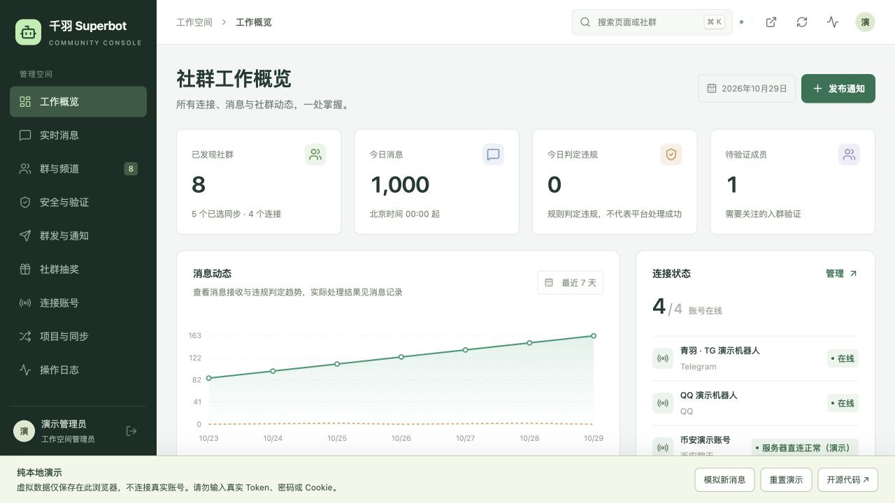
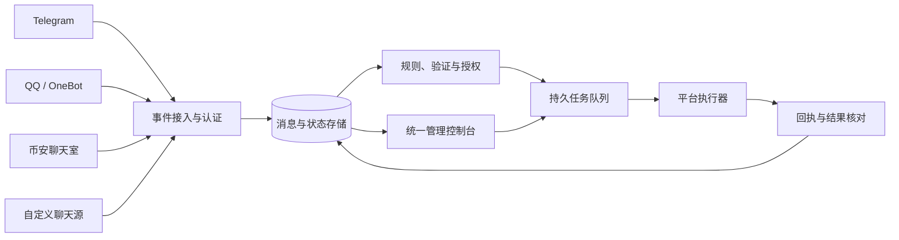
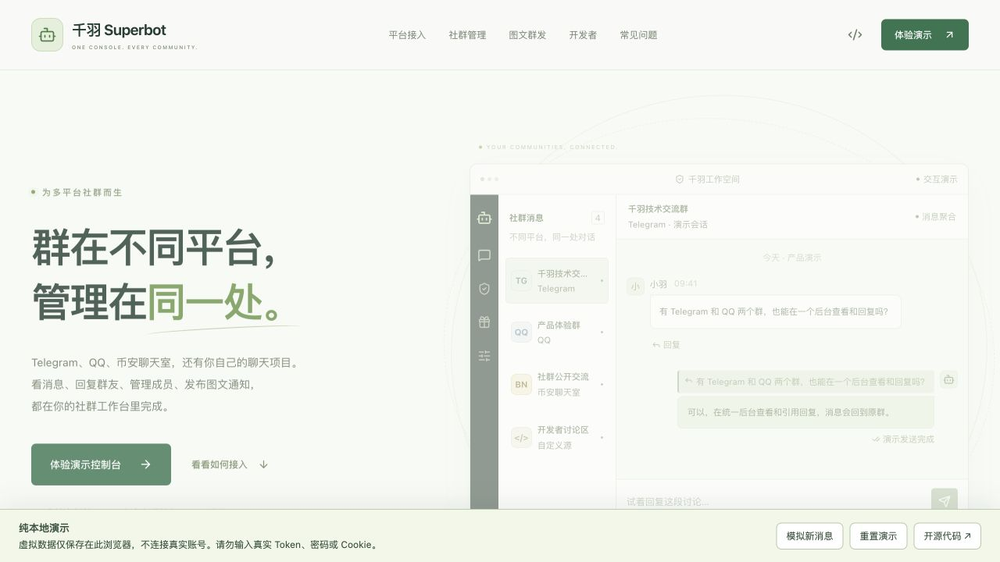

<div align="center">


# QySuperBot

### 千羽超级机器人 · 多平台社群管理工作台

聚合 Telegram、QQ、币安聊天室与自有聊天系统。<br />
从一条消息，到一个社群的日常运营，在同一个工作台里完成。

[](https://github.com/qianyubtc/QySuperBot/actions/workflows/check.yml)
[](LICENSE)
[](package.json)
[](tsconfig.json)
[](docs/vps-deployment.md)

[功能介绍](#功能介绍) · [快速开始](#快速开始) · [平台支持](#平台支持) · [项目接入](#项目接入) · [文档](#文档)

</div>



<p align="center"><sub>产品界面预览，使用程序生成的虚拟账号、社群与消息数据。</sub></p>

## 为什么使用 QySuperBot

社群分布在不同平台，消息、成员和运营任务也随之分散。QySuperBot 将这些日常工作放进统一控制台，同时保留各平台的权限和能力边界。

- **在一处跟进讨论**：查看多平台消息、图片、昵称和头像，带着上下文回复原群。
- **按群配置管理方式**：选择同步范围，配置关键词、域名、黑名单、入群审核与活人验证。
- **准备一次，发布到多个群**：支持文字、单图和图文通知，即时发送或安排单次定时任务。
- **看清每一步的结果**：规则命中、平台处理和消息投递分别记录，失败与结果待核对不会混在一起。
- **接入自己的业务**：通过受限 API Key 发送通知，或用签名连接器协议接入已有聊天项目。
- **在自己的环境运行**：完整前后端、适配器、协议、部署模板与测试代码均包含在仓库中。

## 功能介绍

### 消息与对话

| 功能 | 说明 |
| --- | --- |
| 多平台收件箱 | 聚合已启用同步的社群，支持搜索、平台筛选与快速切群 |
| 实时消息与回复 | SSE 更新消息和投递状态，网页直接发送文本或引用回复原消息 |
| 图片、昵称与头像 | 后台鉴权读取媒体，加载失败显示重试或默认头像 |
| 已存历史翻页 | 基于游标向前加载后台保存的历史，保持阅读位置 |
| 独立草稿 | 各群分别保留编辑内容和引用，切群时保留消息缓存与滚动位置 |
| 同步范围 | 按账号勾选社群；取消同步后停止后续收发与管理任务，历史仍保留 |

### 群管理与成员验证

| 功能 | 说明 |
| --- | --- |
| 广告规则 | 关键词、域名与群级黑名单，支持观察模式和自动处理模式 |
| 权限感知 | 分别核对平台能力和账号权限，网页禁用不支持的动作，执行前再次校验 |
| Telegram 成员管理 | 超级群限时禁言、封禁、警告记录与查询，以及按群开启的管理员命令 |
| QQ 入群审核 | 自动处理符合条件的新入群申请，记录通过、失败、待核对等状态 |
| QQ 活人验证 | @ 机器人或引用题目回答计算题，绑定本人和当前入群批次 |
| 验证后续处理 | 按群配置超时转人工、移出或循环禁言；错答处理与超时处理分别设置 |
| 币安成员管理 | 服务器直连模式下手动禁言、解禁与免费普通群踢人，独立记录执行结果 |

### 社群运营与项目集成

| 功能 | 说明 |
| --- | --- |
| 图文群发 | 文字、单张图片或图片说明，按平台筛选目标群并预览内容 |
| 单次定时消息 | 按北京时间安排发布，每个目标群独立跟踪结果 |
| 社群抽奖 | 群内指令报名、到期复查资格、固定开奖结果，奖品由管理员发放 |
| 群消息同步 | 审核通过的文本单向、单跳同步；机器人发出的消息不再次转发 |
| 项目 API | 按群和动作授权，支持幂等请求及投递结果查询 |
| 自定义聊天源 | 签名事件、群发现、握手、心跳、权限声明、外发命令与最终回执 |

### 连接与执行状态

控制台区分账号离线、暂停、登录失效、平台访问受限、临时网络失败和群权限不足，并提供刷新连接或重新登录入口。

每项任务独立记录以下状态：

```text
等待执行 → 处理中 → 平台已接收 → 成功 / 失败 / 结果待核对
```

**规则命中不等于处理成功。** 超时、断线或矛盾回执导致结果不明时，任务进入待核对，不自动重复发送或叠加成员处分。管理员记录核对依据后，再决定如何处理。

## 平台支持

| 平台 | 接入方式 | 主要能力 | 需要了解 |
| --- | --- | --- | --- |
| Telegram | 官方 Bot API 轮询 | 消息与图片、引用回复、群发、验证按钮、禁言、封禁、警告和管理员命令 | 群列表来自已发现或手动登记的会话；限时禁言仅支持超级群 |
| QQ 普通群 | OneBot v11 / NapCat | 消息与图片、群选择、撤回、移出、扫码登录、自动审核与活人验证 | 个人号非官方接入，需要独立 QQ 客户端；登录与版本变化可能影响稳定性 |
| 币安聊天室 | Chrome 桥接或服务器登录直连 | 群发现、消息与媒体、回复、图文群发；直连提供手动成员管理 | 实验性接口，登录会话可能失效；浏览器桥接需保持网页运行 |
| 自有聊天系统 | 签名 HTTP 连接器 | 群发现、双向消息、能力与权限声明、外发命令和回执 | 需在自己的项目中实现协议对应的读写动作 |

具体管理动作取决于 **连接器支持 ∩ 账号权限 ∩ 群配置 ∩ 同步范围**。未知或过期的权限不会自动获得授权。

<details>
<summary><strong>查看当前限制与实验功能边界</strong></summary>

- 历史翻页读取后台已经保存的消息，不代表能获取平台接入前的全部历史。
- 实时聊天回复当前发送文本；图片与图文请使用“群发与通知”。
- 跨群同步当前为单向、单跳文本同步，编辑、删除和媒体不随路线传播。
- Telegram Bot 无法枚举所有已加入群；提前解除禁言、解封和组合踢出仍在 Telegram 客户端处理。
- QQ 普通群依赖非官方个人号接入。手机确认、账号恢复与平台验证需要账号本人完成。
- 币安禁言持续到手动解禁，踢人仅限免费普通群。付费群踢人、VIP 社群管理、删消息及限时禁言未开放。
- 币安成员管理写操作有隔离回归覆盖，真实成员写入仍需独立测试群验收。不承诺永久令牌或自动续签。
- X 社群独立适配器尚未实现；Discord 不在当前支持范围。
- 当前是单工作空间管理模式，未提供多租户、完整 RBAC、网页密码找回或自动审计清理。

</details>

## 快速开始

### 环境要求

- Node.js **22.18 或更高版本**。
- npm，使用仓库中的 `package-lock.json` 安装依赖。
- 本地开发默认使用 **PGlite**，无需预先安装数据库；生产环境可使用 PostgreSQL。

### 启动完整服务

```bash
git clone https://github.com/qianyubtc/QySuperBot.git
cd QySuperBot

npm ci
cp .env.example .env
npm run dev
```

打开 **http://127.0.0.1:5174** 查看介绍页，从“进入后台”创建首个管理员。API 服务默认监听 **127.0.0.1:3000**，开发服务器自动代理 API 请求。

本地数据默认保存在 `.local/data/`，重启后保留。首次初始化附带两个明确标记的演示社群，可在群详情模拟发言或入群；配置 `SEED_DEMO=false` 可关闭初始演示数据。

### 连接第一个真实社群

1. **连接账号**：添加 TG Bot Token，或使用配置好的 QQ / 币安服务器登录入口。
2. **选择同步群**：刷新已发现的社群，勾选需要接入的群。
3. **核对平台能力**：在群详情查看支持的动作及账号权限。
4. **检查收发**：在独立测试群发言，核对后台同步与回复结果。
5. **配置运营策略**：先观察规则命中，再按需要开启验证、自动处理和发布任务。

QQ 扫码登录需要在服务器上配置 NapCat；币安服务器登录需要 Chrome、Xvfb 和 xauth。它们不是运行 `npm run dev` 后自动安装的依赖，详情见 [运行配置](docs/operations.md) 与 [币安接入指南](docs/binance-chat-integration.md)。

### 构建运行

```bash
npm run check
npm run build
npm start
```

构建后由同一服务提供网页和 API，默认地址为 [http://127.0.0.1:3000](http://127.0.0.1:3000)。生产部署的 HTTPS、初始化凭据、数据库、平台客户端与备份配置见 [VPS 部署指南](docs/vps-deployment.md)。仓库也提供 [Dockerfile](Dockerfile) 和 [Compose 配置](compose.yaml)。

### 纯浏览器交互演示

不准备连接真实账号时，可以单独体验介绍页与控制台：

```bash
npm ci
npm run dev:demo
```

演示使用虚拟账号、社群和消息，回复、群发和管理操作只修改当前浏览器的数据；刷新保留修改，也可通过页面底部一键重置。模拟登录不会访问真实平台，不需要填写真实凭据。

## 项目接入

### 从业务系统发送社群通知

在“项目与同步”创建项目 Key，选择允许访问的社群，并授予所需权限。例如：`conversations.read`、`messages.send` 与 `deliveries.read`。

```bash
curl http://127.0.0.1:3000/api/v1/messages \
  -H "Authorization: Bearer $SUPERBOT_PROJECT_KEY" \
  -H 'Content-Type: application/json' \
  -H 'Idempotency-Key: notification-release-001' \
  -d '{
    "conversation_ids": ["YOUR_CONVERSATION_ID"],
    "text": "新版本已发布，欢迎查看更新。"
  }'
```

`conversation_ids` 使用后台逻辑群 ID，可通过 `GET /api/v1/conversations` 获取。响应返回 `delivery_ids`，随后使用 `GET /api/v1/deliveries/:id` 查询结果。同一个项目与幂等键应保持目标和消息内容一致。

项目 Key 只拥有显式授予的群和动作权限，不能调用后台管理员的成员处分、登录或凭据管理接口。

### 接入已有聊天系统

实现自定义连接器后，你的聊天项目可以和其他平台一起出现在工作台中：

```text
你的聊天项目
  ├─ 上报：签名事件、群资料、权限、心跳
  └─ 接收：消息命令、执行请求
                ↕
           QySuperBot
                ↕
     统一聊天 / 群管理 / 任务与回执
```

协议、请求签名、端点和消息往返示例见 [自有聊天接入指南](docs/custom-chat-integration.md)。进程内参考示例位于 [examples/custom-chat](examples/custom-chat/README.md)。

## 技术架构

| 层级 | 实现 |
| --- | --- |
| 网页 | React 19、TypeScript、Vite、React Router、Lucide |
| 服务端 | NestJS、Node.js，API 与 worker 同进程运行 |
| 数据存储 | PostgreSQL / PGlite，消息、规则、任务、回执与审计持久化 |
| 实时更新 | SSE 聊天快照与投递状态，游标历史分页 |
| 任务处理 | 数据库 outbox、幂等请求、执行前复查、独立尝试与人工核对 |
| 接入协议 | HTTP 签名、账号会话、能力与权限声明、版本化指令和回执 |
| 认证与凭据 | 管理员会话、CSRF、受限项目 Key、AES-256-GCM 凭据加密 |



### 仓库结构

```text
apps/
  admin/                   官网、控制台与纯浏览器演示
  server/                  业务 API、任务、适配器与集成测试
packages/
  contracts/               事件、签名、能力、指令与回执协议
  binance-chat/            币安聊天客户端公共实现
extensions/
  binance-browser/         Chrome 会话桥接扩展
examples/
  custom-chat/             自定义源参考实现
deploy/                    systemd、Caddy 等部署模板
docs/                      架构、协议、接入和运行说明
```

## 开发与验证

```bash
npm run typecheck          # 类型检查
npm test                   # 服务端、协议及隔离集成测试
npm run test:demo          # 浏览器演示的数据隔离与状态回归
npm run build              # 完整服务与管理台构建
npm run build:demo         # 纯前端演示构建
```

测试覆盖权限与账号绑定、同步范围、幂等投递、失败与待核对状态、成员管理、验证流程、媒体、历史分页及演示隔离。持续集成配置见 [Check workflow](.github/workflows/check.yml)。模拟测试覆盖不等同于真实平台兼容性或长期运行验收。

## 文档

| 文档 | 内容 |
| --- | --- |
| [运行与配置](docs/operations.md) | 环境变量、平台连接、成员管理、验证、实时消息与任务恢复 |
| [VPS 部署](docs/vps-deployment.md) | 服务进程、反向代理、QQ 桥接、更新与备份 |
| [币安聊天接入](docs/binance-chat-integration.md) | 服务器登录、浏览器桥接、权限与实验能力边界 |
| [自有聊天接入](docs/custom-chat-integration.md) | 签名认证、群发现、事件、命令与回执 |
| [连接器协议](docs/connector-protocol.md) | Schema、会话、能力、幂等和版本约定 |
| [系统架构](docs/architecture.md) | 运行模式、核心模块、数据流与权限模型 |
| [安全说明](SECURITY.md) | 凭据、部署与问题反馈中的信息保护 |

<details>
<summary>查看介绍页预览</summary>



</details>

## 参与贡献

欢迎提交问题反馈、平台适配、交互改进和文档修正。

- 反馈问题时说明平台、运行环境、复现步骤和预期行为，并隐藏账号、群内私人内容和所有凭据。
- 涉及平台动作的修改，请说明适用权限、失败处理和回执语义，避免把“已提交”当作“已完成”。
- 提交代码前运行类型检查、相关测试和构建；平台真实操作请在自己的专用测试群进行。
- 不提交 `.env`、数据库、登录状态、Token、Cookie、私钥、配对配置或部署备份。

## 许可证

本项目基于 [MIT License](LICENSE) 开源。
